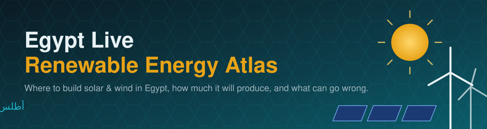
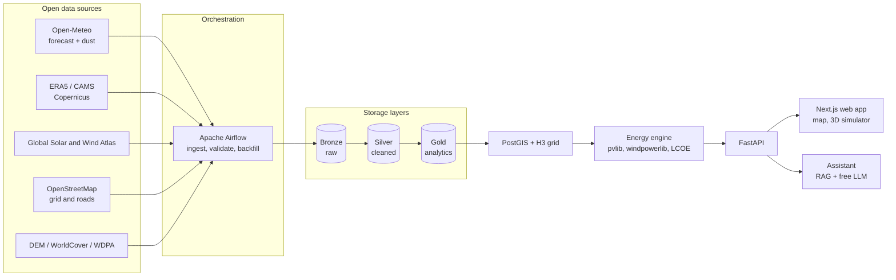

<div align="center">



### An open, data-driven platform that tells you **where to build solar & wind in Egypt**, **how much it will produce**, and **what can go wrong** — in plain language.

<br>


[Overview](#overview) · [Architecture](#architecture) · [Screens](#product-screens) · [Quick Start](#quick-start) · [DEPI Mapping](#how-this-project-maps-to-the-depi-curriculum) · [Roadmap](#roadmap) · [Team](#team-data-titans)

</div>

---

## Overview

Egypt has some of the world's best solar radiation and strong wind corridors in the Gulf of Suez and the Red Sea. Choosing *where* to build is still slow and expensive, and global atlases only answer part of the question: they show the **resource**, but not the dust, the grid distance, the flash-flood risk or the final cost.

**Egypt Live Renewable Energy Atlas** closes that gap. It combines live weather and global GIS layers in one hexagonal grid, runs transparent physical models on top, and turns the result into a decision a non-technical person can read.

| Question | What the platform gives you |
|---|---|
| **Where should we build?** | A ranked map of candidate sites by estimated cost per kWh, resource, grid distance and risk, with weights the user controls |
| **How much will it produce?** | Production estimates as a **P50 / P90 range**, including losses from heat and dust, plus a 72-hour live forecast |
| **What can go wrong?** | Flash-flood, dust, grid, protected-area and bird-migration constraints, each explained in Arabic and English |

> **Project status:** the engineering foundation is complete (reproducible environments, containerised infrastructure, repository layout, website skeleton). Data pipelines, models and screens are being implemented. See the [Roadmap](#roadmap).

## What makes it different

1. **Dust inside the production model**, not an afterthought, with a cleaning-schedule recommendation per site.
2. **Hourly solar + wind complementarity** to reduce storage needs.
3. **Grid cost inside the decision**: ranking by estimated LCOE, not by radiation alone.
4. **Risk filters**: flash-flood channels from terrain analysis, protected areas, land cover and bird-migration corridors.
5. **A live operational view**: 72-hour production forecast, not a one-off feasibility study.
6. **Honest uncertainty**: every number comes with a range, its formula and its source.
7. **User-controlled weights**: an investor and a ministry can rank the same sites differently.
8. **An assistant that explains** every result, grounded in the platform's own data and documentation.

## Product screens

The website is a Next.js application (static export, so it can be hosted for free). The route structure is in place and each screen is being built.

| Screen | Purpose |
|---|---|
| **Home** | The three questions, key differentiators, entry points |
| **Map** | 3D hexagonal map of Egypt, technology selector, adjustable weights, top sites |
| **Site details** | Production range, cost, risks and a "why this ranking?" explanation |
| **Compare** | Side-by-side comparison of 2–4 sites, printable |
| **Live forecast** | 72-hour solar and wind output, dust and high-wind alerts |
| **3D simulator** | Interactive plant: move the sun, wind and dust, and watch output change |
| **Assistant** | Free chatbot that answers questions about the system and cites sources |
| **Methodology** | Formulas, data sources and the limits of the platform |

## Architecture



**Design principles:** idempotent and re-runnable pipelines, raw data never modified, data-quality checks between layers (Pandera, dbt tests), one shared spatial key (H3 cell id) for all sources, and a static-first deployment that costs nothing to host.

## Tech stack (100% free and open source)

| Layer | Tools |
|---|---|
| **Orchestration** | Apache Airflow |
| **Storage** | PostgreSQL + PostGIS, pgvector, Parquet / Zarr files |
| **Transformation & quality** | dbt, DuckDB, Polars, Pandera |
| **Geo & climate processing** | GeoPandas, rasterio, xarray, Dask, H3, OSMnx |
| **Energy modelling** | pvlib, windpowerlib, scikit-learn, LightGBM |
| **Backend** | FastAPI, Pydantic |
| **Frontend** | Next.js, React, TypeScript, MapLibre GL, deck.gl, three.js / react-three-fiber |
| **AI assistant** | Retrieval-augmented generation, sentence-transformers, free local or free-tier LLMs (Ollama) |
| **DevOps** | Docker Compose (profiles), GitHub Actions, pre-commit, Ruff, pytest |
| **Optional services** | Redis, Kafka, Prometheus, Grafana, Metabase, MLflow, Martin tiles, MongoDB, ClickHouse |

## Repository structure

```text
.
├── web/                 Next.js website (screens, map, 3D simulator)
├── data_engineering/    The core track: pipelines and warehouse
│   ├── dags/            Airflow DAGs
│   ├── ingestion/       Source extractors (Open-Meteo, ERA5, OSM, ...)
│   ├── warehouse/       dbt project: staging -> analytics
│   ├── config/          Configuration (governorates, ...)
│   └── lake/            Local data (git-ignored)
├── engine/              Pure energy and economics code (PV, wind, LCOE, ranking)
├── api/                 FastAPI backend
├── assistant/           RAG assistant
├── infra/               Docker build contexts
├── setup/               One-command machine setup + verification
├── docs/                Specification, setup, performance, deployment
├── tests/               Automated tests
├── docker-compose.yml   All services, started on demand with profiles
└── environment.yml      Single source of truth for Python libraries
```

Each folder has its own `README.md` explaining what belongs there.

## Quick start

**Requirements:** Git, VS Code, Node.js (LTS). For the data track also Anaconda and Docker Desktop. Full list: [`setup/PROGRAMS.md`](setup/PROGRAMS.md).

```powershell
git clone https://github.com/mostafaxz723/Enterprise-Data-Intelligence-Platform-EDIP-.git egypt-energy-atlas
cd egypt-energy-atlas

# Pick ONE role (safe to re-run, never deletes anything):
powershell -ExecutionPolicy Bypass -File setup\bootstrap.ps1 -Role web     # website only (light laptops)
powershell -ExecutionPolicy Bypass -File setup\bootstrap.ps1 -Role data    # data engineering (conda + Docker)
powershell -ExecutionPolicy Bypass -File setup\bootstrap.ps1               # everything
```

Linux / macOS: `bash setup/bootstrap.sh --role all`. Step-by-step guide with troubleshooting: [`START-HERE.md`](START-HERE.md).

**Run it:**

```powershell
docker compose up -d                      # PostGIS only (lightweight)
docker compose --profile airflow up -d    # + Airflow      -> http://localhost:8080
docker compose --profile app up -d        # + API          -> http://localhost:8000/docs
cd web && npm run dev                     # website        -> http://localhost:3000
.\setup\stack.ps1 stop                    # stop everything (data is kept)
```

<details>
<summary><b>Docker services and ports</b> (nothing starts unless you ask for it)</summary>

| Profile | Services | Port | Approx. RAM |
|---|---|---|---|
| *(default)* | PostGIS | 5433 | ≤ 1 GB |
| `vectors` | pgvector (assistant) | 5434 | ≤ 0.5 GB |
| `airflow` | Airflow + metadata DB | 8080 | 2–3 GB |
| `app` | FastAPI | 8000 | ~0.5 GB |
| `cache` | Redis | 6379 | ≤ 0.2 GB |
| `monitoring` | Prometheus + Grafana | 9090 / 3001 | ~1 GB |
| `bi` · `ml` · `tiles` | Metabase · MLflow · Martin | 3002 · 5000 · 3003 | 0.3–1.5 GB |
| `streaming` · `nosql` · `olap` | Kafka · MongoDB · ClickHouse | 9092 · 27018 · 8123 | 0.5–1 GB |
| `dbt` | on demand: `docker compose run --rm dbt run` | — | temporary |

Every service has a memory cap. Do not run more than 2–3 profiles at once on a 16 GB laptop. Tips: [`docs/PERFORMANCE.md`](docs/PERFORMANCE.md).
</details>

## Data sources

All open or free for non-commercial use. Licences and limits must be checked per source before production use.

| Source | Used for |
|---|---|
| [Open-Meteo](https://open-meteo.com) | Hourly forecasts, dust, air quality |
| [ERA5 / CAMS (Copernicus)](https://cds.climate.copernicus.eu) | Historical weather, dust forecasts |
| [Global Solar Atlas](https://globalsolaratlas.info) · [Global Wind Atlas](https://globalwindatlas.info) · [PVGIS](https://re.jrc.ec.europa.eu/pvg_tools) | Resource reference and validation |
| [Copernicus DEM](https://dataspace.copernicus.eu) · [ESA WorldCover](https://esa-worldcover.org) | Terrain, slope, drainage, land cover |
| [OpenStreetMap](https://www.openstreetmap.org) | Power grid, roads, settlements |
| [Protected Planet (WDPA)](https://www.protectedplanet.net) · [WorldPop](https://www.worldpop.org) | Protected areas, population |

Full details, resolutions and access methods: [`docs/SPEC.md`](docs/SPEC.md) (section 6).

## How this project maps to the DEPI curriculum

Built by trainees of the **Digital Egypt Pioneers Initiative (DEPI)** — *AI & Data Science · Microsoft Data Engineer* track. Each course has a concrete counterpart in the project:

| DEPI course | Where it shows up in the project |
|---|---|
| Intro to Data Engineering | Layered architecture (bronze / silver / gold), ELT design, [`docs/SPEC.md`](docs/SPEC.md) |
| Programming Essentials | Clean, tested, linted code in `engine/` and CI |
| SQL & Database Management | PostGIS schemas, spatial queries, dbt models |
| Advanced Python for Data Engineering | Resilient extractors (retries, validation), Pandera contracts, pytest |
| Data Pipelines | Airflow DAGs: scheduling, idempotency, backfill, data-quality gates |
| Big Data Processing | Climate-scale data with Parquet / Zarr, Dask, Polars and DuckDB |
| Microsoft Azure Data Engineer Associate | Azure migration path (table below) |
| Deployment | Docker Compose, GitHub Actions CI/CD, free static hosting |
| AI for Data Engineers | RAG assistant, ML bias-correction and uncertainty estimation |
| Prompt Engineering | Grounded prompts, guardrails and evaluation for the assistant |

**Azure equivalents** (the project runs on a free open-source stack; this is how each part maps to Azure):

| This project | Azure service |
|---|---|
| Apache Airflow | Azure Data Factory / Microsoft Fabric pipelines |
| Parquet / Zarr data lake | Azure Data Lake Storage Gen2 |
| PostgreSQL + PostGIS | Azure Database for PostgreSQL |
| dbt + DuckDB / Polars | Microsoft Fabric Warehouse / Synapse |
| Dask for large rasters | Azure Databricks / Synapse Spark |
| Kafka | Azure Event Hubs |
| Prometheus + Grafana | Azure Monitor |
| Metabase | Power BI |
| MLflow | Azure Machine Learning |
| `.env` secrets | Azure Key Vault |

## Roadmap

- [x] Repository, collaboration rules and CI
- [x] Reproducible environments (conda, npm) and one-command setup
- [x] Containerised infrastructure with on-demand profiles
- [x] Website skeleton with all eight screen routes
- [ ] Ingestion DAGs (hourly forecast, dust, ERA5 backfill)
- [ ] H3 grid of Egypt and static layers (terrain, land cover, grid, protected areas)
- [ ] Energy engine (PV with dust, wind, hybrid complementarity, LCOE)
- [ ] Site ranking, risk filters and public API
- [ ] Web screens: map, site details, compare, forecast
- [ ] 3D simulator
- [ ] Free assistant (RAG + tools)
- [ ] Validation against PVGIS / Global Atlases and public deployment

## Team: Data Titans

| Member | Role |
|---|---|
| **Mostafa Mohamed Atef** ([@mostafaxz723](https://github.com/mostafaxz723)) | Team Lead & Data Engineer |
| **Hoda Lotfy Elkassas** ([@hoda-elkassas](https://github.com/hoda-elkassas)) | Data Engineer |
| **Waleed Ahmed Anwer** | Data Engineer |
| **Malak Ahmed Naga** ([@malaknaga](https://github.com/malaknaga900-ai)) | Data Engineer |
| **Asmaa Mohamed sadallah** | Data Engineer |
| **Mahmoud Fayez Khedr** ([@mahmoud19000](https://github.com/mahmoud19000)) | Data Engineer |

## Contributing

We work with short-lived branches and pull requests. Read [`CONTRIBUTING.md`](CONTRIBUTING.md) first. Golden rules: never commit `.env`, add every new library to `environment.yml` immediately, and open a pull request instead of pushing to `main`.

## Data attribution and disclaimer

This is a **planning-level decision-support tool**, not a bankable feasibility study. Results do not replace on-site measurement or official permitting. Map data © OpenStreetMap contributors (ODbL); Copernicus, ESA WorldCover, Global Solar/Wind Atlas, WorldPop and other sources are used under their own licences and must be credited where shown. Code licence: to be confirmed by the team.

<div align="center">

**Built in Egypt, for Egypt's energy transition.**

</div>
