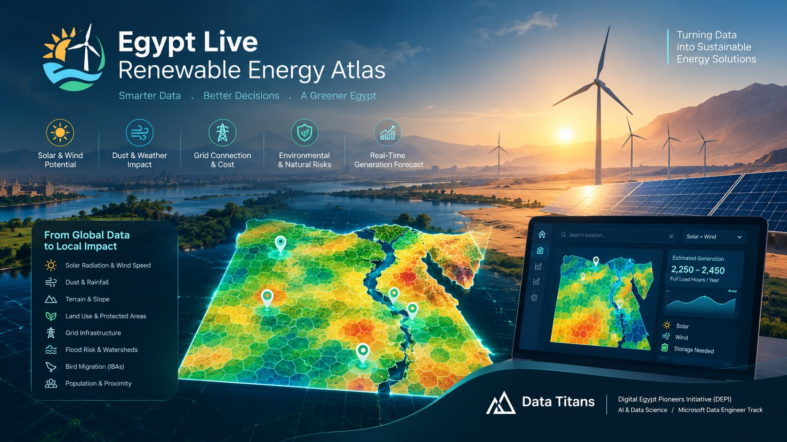
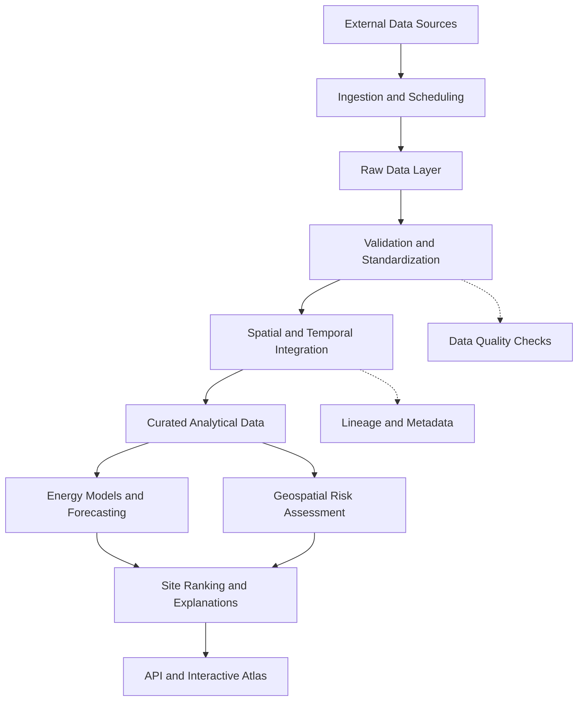
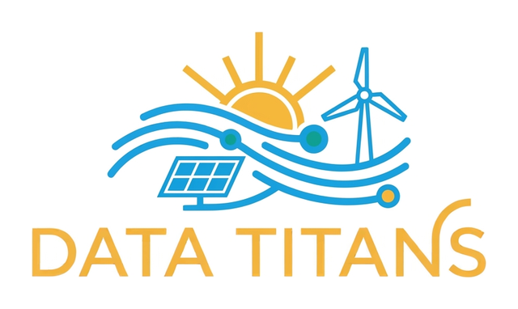

<div align="center">



<sub><i>Concept illustration. The interface and values shown are a design vision of the planned platform.</i></sub>

<h3>Where should we build? How much energy can we realistically generate? What risks should we consider?</h3>

A data engineering platform that turns open weather and geospatial data into transparent, explainable renewable energy site assessments for Egypt.

<br>

[](#overview)
[](#planned-key-features)
[](#data-engineering-architecture)
[](#getting-started)
[](#roadmap)
[](#team-data-titans)


**A team project by Data Titans** · Digital Egypt Pioneers Initiative (DEPI) · AI & Data Science — Microsoft Data Engineer Track

</div>

---

## Project status at a glance

| Area | Status | What exists today |
|---|---|---|
| **Engineering foundation** | ✅ Ready | Repository layout, reproducible environments, one-command setup, containerised infrastructure, CI |
| **Website skeleton** | ✅ Ready | Next.js project with all eight screen routes in place |
| **Data pipelines** | 🚧 In progress | Airflow and PostGIS are provisioned; source extractors are being built |
| **Energy models & ranking** | 🔜 Planned | pvlib / windpowerlib workflows and scoring |
| **Interactive atlas & assistant** | 🔜 Planned | Map, 3D simulator, explanations, free chatbot |

> Features described below are **planned capabilities** unless marked otherwise. Nothing is claimed as implemented or validated before it is.

<details open>
<summary><b>Table of contents</b></summary>

- [Overview](#overview) · [The problem](#the-problem) · [Our approach](#our-approach)
- [Planned key features](#planned-key-features) · [Product screens](#product-screens)
- [Data engineering architecture](#data-engineering-architecture) · [Technology stack](#technology-stack)
- [Data sources](#data-sources) · [Modeling and validation](#modeling-and-validation)
- [Repository structure](#repository-structure) · [Getting started](#getting-started)
- [Roadmap](#roadmap) · [Team](#team-data-titans) · [Scope and limitations](#scope-and-limitations)

</details>

## Overview

Egypt has substantial solar and wind potential, yet choosing a location takes more than finding high irradiation or strong wind. Dust accumulation, heat, terrain, flood exposure, land-use restrictions, grid accessibility and the hourly complementarity of solar and wind all shape a project's feasibility and performance.

**Egypt Live Renewable Energy Atlas** is a geospatial data engineering platform that integrates environmental, meteorological, energy and infrastructure datasets into one consistent analytical foundation, so candidate sites can be compared, their generation estimated, and the reasons behind each recommendation explained.

Its central idea is simple: **move beyond a resource map toward a transparent decision-support tool.**

| Question | Planned answer |
|---|---|
| **Where should we build?** | Identify and rank candidate locations using renewable resources, geospatial conditions, infrastructure accessibility and relevant constraints. |
| **How much energy could we generate?** | Estimate generation from weather inputs and physics-based models, accounting for system losses and uncertainty (P50 / P90 ranges). |
| **What could affect feasibility?** | Assess dust losses, terrain and flood exposure, land-use constraints, grid accessibility and data limitations. |

## The problem

Site assessment needs data from many sources, formats, resolutions and time periods, and resource-only assessments can overlook practical constraints.

- **Resource data alone is not enough.** High irradiation or wind speed does not make a site the best overall choice.
- **Dust and heat matter.** They can reduce photovoltaic output compared with idealised estimates.
- **Infrastructure affects feasibility.** A promising site may be far from mapped grid infrastructure, and proximity alone does not guarantee connection capacity.
- **Terrain and environment matter.** Protected areas, land cover, slope and potential flood pathways must be considered.
- **Solar and wind vary over time.** Hourly complementarity can explain variability and inform storage scenarios.
- **Results must be explainable.** Users should be able to inspect the data, assumptions and factors behind every score.

## Our approach

| | Capability | What it does |
|---|---|---|
| 1 | **Data engineering** | Ingest, validate, standardise, store and update datasets from multiple sources |
| 2 | **Geospatial analytics** | Align data on a shared spatial framework (H3) and screen candidate sites |
| 3 | **Energy modeling** | Estimate solar and wind generation with documented physical models |
| 4 | **Decision support** | Compare and rank sites with configurable criteria, explanations and uncertainty |

The goal is **not** to replace detailed engineering studies or established resource atlases, but to connect resource estimates with local environmental, infrastructure and operational considerations.

## Planned key features

| Feature | Description |
|---|---|
| **Multi-criteria site selection** | Rank sites by resource potential, terrain, land cover, environmental constraints and infrastructure, with a documented method |
| **Dust-aware solar estimates** | A configurable soiling model driven by dust and precipitation, with approximate cleaning schedules |
| **Combined solar and wind analysis** | Hourly complementarity and scenario-based storage exploration |
| **Grid and economic screening** | Proximity to mapped grid features and approximate connection-cost scenarios; LCOE when defensible inputs exist |
| **Risk screening** | Slope, drainage and flood pathways, protected areas, land cover, settlements, and bird-sensitive areas where reliable data exist |
| **Short-term forecasting** | Up to 72-hour solar and wind generation estimates, clearly separated from measured plant output |
| **Explainable, configurable ranking** | Users adjust the weight of yield, cost, grid access and constraints and see why a site scores as it does |
| **Interactive map and reports** | Candidate profiles, side-by-side comparison, forecast view and downloadable reports |

<details open>
<summary><b>Important caveats for these features</b></summary>

- Dust concentration is not a direct measurement of dust deposited on panels; soiling estimates need calibration and are presented as approximations.
- Mapped infrastructure does not prove a connection point exists, has spare capacity, or is available at a given cost.
- Risk layers are for **preliminary screening**, not a substitute for official permitting or environmental impact assessment.
- Facility case studies (for example Benban, Zafarana, Gabal El Zeit) are estimates and must not be confused with measured plant output.
</details>

## Product screens

The website is a Next.js application (static export, hostable for free). All routes exist; each screen is being built.

| Screen | Purpose |
|---|---|
| **Home** | The three questions, differentiators and entry points |
| **Map** | 3D hexagonal map of Egypt, technology selector, adjustable weights, top sites |
| **Site details** | Production range, cost, risks and a "why this ranking?" explanation |
| **Compare** | Side-by-side comparison of 2–4 sites, printable |
| **Live forecast** | 72-hour solar and wind output with dust and high-wind alerts |
| **3D simulator** | Interactive plant: change sun, wind and dust and watch output respond |
| **Assistant** | Free chatbot that answers questions about the system and cites its sources |
| **Methodology** | Formulas, data sources and the limits of the platform |

## Data engineering architecture

Data engineering is the foundation of the project: a **repeatable, quality-controlled data platform**, not a one-time collection of datasets.



| Layer | Responsibility | Technologies |
|---|---|---|
| **Ingestion** | Retrieve weather, dust, historical and geospatial data | Python, HTTP APIs, Open-Meteo, Copernicus services |
| **Orchestration** | Schedule jobs, dependencies, retries and backfills | Apache Airflow |
| **Raw storage** | Preserve source data and enable efficient processing | Parquet, Zarr |
| **Data quality** | Check schemas, missing values, duplicates, ranges, consistency | Pandera, dbt tests |
| **Spatial integration** | Standardise spatial references and link data to grid cells | GeoPandas, Rasterio, H3 |
| **Analytical storage** | Store spatial layers and query-ready data | PostgreSQL, PostGIS |
| **Transformation** | Reusable analytical models and SQL transformations | SQL, dbt, DuckDB |
| **Energy modeling** | Estimate solar and wind generation | pvlib, windpowerlib |
| **API** | Serve site assessments and results | FastAPI |
| **Web application** | Maps, comparisons and results | Next.js, MapLibre GL JS, deck.gl, three.js |

<details open>
<summary><b>Spatial and temporal integration principles</b></summary>

- **H3 spatial indexing** gives one shared key for candidate-site analysis.
- **Time alignment** standardises timestamps and time zones and reconciles hourly forecasts with historical or reanalysis data.
- **Data contracts** define expected fields, types, ranges, uniqueness rules and missing-data expectations.
- **Backfills and reproducibility** allow historical reprocessing when sources or logic change.
- **Lineage and provenance** record source identifiers, retrieval times and transformation versions.
- **Efficient processing** uses partitioned data, Dask and Zarr to control memory use.

Converting data to H3 does not create spatial detail that the original data did not have.
</details>

## Technology stack

100% free and open source.

| Area | Tools |
|---|---|
| **Languages & processing** | Python, SQL, pandas, NumPy, xarray, Polars, DuckDB, Dask |
| **Geospatial** | GeoPandas, Rasterio, H3, OSMnx |
| **Data engineering & storage** | Apache Airflow, PostgreSQL + PostGIS, pgvector, Parquet / Zarr, dbt, Pandera |
| **Energy modeling & ML** | pvlib, windpowerlib, scikit-learn, LightGBM |
| **Backend** | FastAPI, Pydantic |
| **Frontend** | Next.js, React, TypeScript, MapLibre GL JS, deck.gl, three.js / react-three-fiber |
| **AI assistant** | Retrieval-augmented generation, sentence-transformers, free local or free-tier LLMs (Ollama) |
| **DevOps & quality** | Docker Compose (on-demand profiles), GitHub Actions, pre-commit, Ruff, pytest |

## Data sources

<details open>
<summary><b>Candidate sources</b> (exact datasets, coverage, licences and update schedules must be verified before use)</summary>

| Source | Intended use |
|---|---|
| [Open-Meteo](https://open-meteo.com) | Weather forecasts and supported atmospheric variables |
| [Copernicus ERA5 / ERA5-Land](https://cds.climate.copernicus.eu) | Historical meteorological and land-surface analysis |
| [Copernicus CAMS](https://ads.atmosphere.copernicus.eu) | Atmospheric composition and suitable dust-related variables |
| [NASA POWER](https://power.larc.nasa.gov) | Solar and meteorological reference data |
| [Copernicus DEM](https://dataspace.copernicus.eu) | Elevation and terrain analysis |
| [ESA WorldCover](https://esa-worldcover.org) | Land-cover classification |
| [OpenStreetMap](https://www.openstreetmap.org) | Roads, settlements and mapped infrastructure |
| [Protected Planet (WDPA)](https://www.protectedplanet.net) | Protected-area screening |
| [WorldPop](https://www.worldpop.org) | Population distribution |
| [PVGIS](https://re.jrc.ec.europa.eu/pvg_tools) | Independent solar generation comparison |
| [Global Solar Atlas](https://globalsolaratlas.info) · [Global Wind Atlas](https://globalwindatlas.info) | Solar and wind resource references |
| [H3](https://h3geo.org) | Hexagonal spatial indexing |
| [WRI power-plant datasets](https://datasets.wri.org) | Power-plant reference data, subject to availability |

**Availability note:** electrical network data, plant-level generation observations, flood-related inputs and bird-sensitivity layers need additional source-specific verification. Public availability does not guarantee completeness or suitability. Attribution and licence terms will be documented for every dataset used.
</details>

## Modeling and validation

- **Solar (pvlib):** solar position, plane-of-array irradiance, module temperature, system losses and dust-related soiling assumptions.
- **Wind (windpowerlib):** wind-speed adjustment to hub height, turbine power curves, air density and system assumptions.
- **Validation:** outputs are compared with independent references such as PVGIS and the Global Solar / Wind Atlas where technically meaningful.
- **Transparency:** we separate model estimates, independent reference estimates, measured observations, and assumptions with uncertainty ranges.

> No accuracy percentage or performance claim is published without a documented evaluation method and suitable validation data.

The full formulas and design are in [`docs/SPEC.md`](docs/SPEC.md).

## Repository structure

```text
.
├── web/                 Next.js website (screens, map, 3D simulator)
├── data_engineering/    Core track: pipelines and warehouse
│   ├── dags/            Airflow DAGs
│   ├── ingestion/       Source extractors (Open-Meteo, ERA5, OSM, ...)
│   ├── warehouse/       dbt project: staging -> analytics
│   ├── config/          Configuration (governorates, ...)
│   ├── notebooks/       Exploration and experiments
│   └── lake/            Local data (git-ignored)
├── engine/              Pure energy and economics code (PV, wind, LCOE, ranking)
├── api/                 FastAPI backend
├── assistant/           RAG assistant
├── infra/               Docker build contexts
├── setup/               One-command machine setup and verification
├── docs/                Specification, setup, performance, deployment
├── tests/               Automated tests
├── docker-compose.yml   All services, started on demand with profiles
└── environment.yml      Single source of truth for Python libraries
```

Every folder has its own `README.md` explaining what belongs there.

## Getting started

**Requirements:** Git, VS Code and Node.js (LTS). For the data track also Anaconda and Docker Desktop. Full list: [`setup/PROGRAMS.md`](setup/PROGRAMS.md).

```powershell
git clone https://github.com/mostafaxz723/Enterprise-Data-Intelligence-Platform-EDIP-.git egypt-energy-atlas
cd egypt-energy-atlas

# Pick ONE role (safe to re-run, never deletes anything):
powershell -ExecutionPolicy Bypass -File setup\bootstrap.ps1 -Role web     # website only (light laptops)
powershell -ExecutionPolicy Bypass -File setup\bootstrap.ps1 -Role data    # data engineering (conda + Docker)
powershell -ExecutionPolicy Bypass -File setup\bootstrap.ps1               # everything
```

Linux / macOS: `bash setup/bootstrap.sh --role all`. A detailed step-by-step onboarding guide (Windows, Ubuntu, other systems) is in [`docs/onboarding/`](docs/onboarding/README.md); the team workflow is in [`CONTRIBUTING.md`](CONTRIBUTING.md).

```powershell
docker compose up -d                      # PostGIS only (lightweight)
docker compose --profile airflow up -d    # + Airflow  -> http://localhost:8080
docker compose --profile app up -d        # + API      -> http://localhost:8000/docs
cd web; npm run dev                       # website    -> http://localhost:3000
.\setup\stack.ps1 stop                    # stop everything (data is kept)
```

<details open>
<summary><b>Docker services and ports</b> (nothing starts unless you ask for it)</summary>

| Profile | Services | Port | Approx. RAM |
|---|---|---|---|
| *(default)* | PostGIS | 5433 | ≤ 1 GB |
| `vectors` | pgvector (assistant) | 5434 | ≤ 0.5 GB |
| `airflow` | Airflow + metadata DB | 8080 | 2–3 GB |
| `app` | FastAPI | 8000 | ~0.5 GB |
| `cache` | Redis | 6379 | ≤ 0.2 GB |
| `monitoring` | Prometheus + Grafana | 9090 / 3001 | ~1 GB |
| `bi` · `ml` · `tiles` | Metabase · MLflow · Martin | 3002 · 5000 · 3003 | 0.3–1.5 GB |
| `streaming` · `nosql` · `olap` | Kafka · MongoDB · ClickHouse | 9092 · 27018 · 8123 | 0.5–1 GB |
| `dbt` | on demand: `docker compose run --rm dbt run` | — | temporary |

Every service has a memory cap. On a 16 GB laptop, do not run more than 2–3 profiles at once. Tips: [`docs/PERFORMANCE.md`](docs/PERFORMANCE.md).
</details>

Never commit API keys, credentials or `.env` files. Use `.env.example` for variable names only.

## Roadmap

Developed incrementally: a reliable data foundation first, then models, then the application.

- [ ] **Phase 1 — Data foundation**
  - [x] Repository structure, source inventory and one-command setup
  - [ ] Initial H3 grid for Egypt
  - [ ] A small, documented subset of historical solar and weather data
  - [ ] Initial data contracts and quality checks
- [ ] **Phase 2 — Geospatial integration**: terrain, land-cover, protected-area and infrastructure layers; standardised spatial and temporal references; first resource-potential map
- [ ] **Phase 3 — Energy estimation**: solar and wind models, dust-related losses, comparison with independent references, documented assumptions and uncertainty
- [ ] **Phase 4 — Site ranking**: transparent scoring criteria, infrastructure and risk information, explanations of the main ranking factors
- [ ] **Phase 5 — Application**: API, interactive map, site profiles, comparisons and report exports connected to validated pipeline results
- [ ] **Phase 6 — Advanced capabilities**: short-term forecasting, combined solar–wind scenarios and storage, further risk layers, Arabic-language explanations

Items are marked complete only after implementation and verification, and the roadmap may change with data availability and feasibility.

## Team Data Titans

<div align="center">



**A collaborative team project under the Digital Egypt Pioneers Initiative (DEPI)**
AI & Data Science — Microsoft Data Engineer Track

<table>
  <tr>
    <td align="center" width="200">
      <a href="https://github.com/mostafaxz723">
        <br>
        <b>Mostafa Mohamed ElNorag</b>
      </a><br>
      <sub>Team Lead & Data Engineer</sub>
    </td>
    <td align="center" width="200">
      <a href="https://github.com/hoda-elkassas">
        <br>
        <b>Hoda Lotfy Elkassas</b>
      </a><br>
      <sub>Data Engineer</sub>
    </td>
    <td align="center" width="200">
      <a href="https://github.com/Asmaa-Elbialy">
        <br>
        <b>Asmaa Mohamed Sadallah</b>
      </a><br>
      <sub>Data Engineer</sub>
    </td>
  </tr>
  <tr>
    <td align="center" width="200">
      <a href="https://github.com/mahmoud19000">
        <br>
        <b>Mahmoud Fayez Khedr</b>
      </a><br>
      <sub>Data Engineer</sub>
    </td>
    <td align="center" width="200">
      <a href="https://github.com/malaknaga900-ai">
        <br>
        <b>Malak Ahmed Naga</b>
      </a><br>
      <sub>Data Engineer</sub>
    </td>
    <td align="center" width="200">
      <br>
      <b>Waleed Ahmed Seliem</b><br>
      <sub>Data Engineer · GitHub coming soon</sub>
    </td>
  </tr>
</table>

<sub>-----------------------------------------------------</sub>

</div>

## Expected impact

The project aims to support more comprehensive, transparent and reproducible early-stage renewable energy screening in Egypt: better-informed comparison of candidate sites, more realistic generation estimates, earlier identification of terrain, environmental and infrastructure constraints, a better understanding of solar–wind complementarity, and a reusable data foundation for future analytics. These are intended benefits, not measured outcomes; impact claims will require evidence from the completed implementation and its evaluation.

## Scope and limitations

Egypt Live Renewable Energy Atlas is an **early-stage decision-support and research platform**. It is not a substitute for a professional feasibility study, field measurements, grid-connection assessment, official permitting or environmental impact assessment.

- Public datasets may be incomplete, inconsistent or outdated.
- Mapped infrastructure does not guarantee grid capacity or connection availability.
- Generation estimates depend on input quality, model configuration and system assumptions.
- Dust-loss estimates and cleaning recommendations require calibration.
- Environmental constraints must be checked against authoritative data and applicable regulations.
- Economic rankings depend on documented cost assumptions and are not investment guarantees.

The platform aims to communicate data gaps, assumptions and uncertainty alongside its outputs.

## Collaboration

We work with short-lived branches, descriptive commits and pull requests. See [`CONTRIBUTING.md`](CONTRIBUTING.md). In short: never commit `.env`, add every new library to `environment.yml` immediately, document data sources and assumptions, and record known limitations instead of filling gaps with unsupported assumptions.

## Acknowledgments

We thank the data providers, research institutions and open-source communities whose datasets and tools support this project, including Copernicus, NASA, Open-Meteo, ESA, OpenStreetMap contributors (© OpenStreetMap contributors, ODbL), PVGIS, and the Global Solar and Wind Atlas projects. Attribution and licensing requirements are reviewed per dataset and dependency. Code licence: to be confirmed by the team.

<div align="center">

<br>

**Data Titans** — *Turning renewable energy data into better decisions for Egypt.*

Digital Egypt Pioneers Initiative · AI & Data Science — Microsoft Data Engineer Track

</div>
